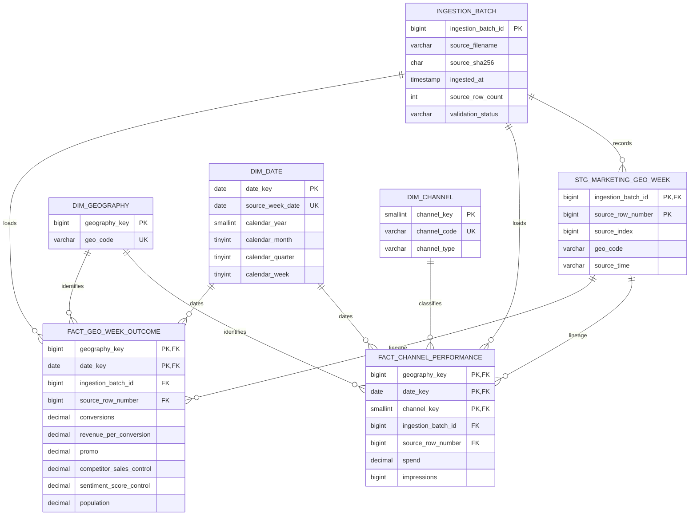

# MarketMosaic MySQL 8.x Database Design

**Schema DDL:** [`sql/001_create_schema.sql`](../sql/001_create_schema.sql)  
**Source dataset:** `data/raw/geo_all_channels.csv`  
**Status:** Schema implemented and verified against the local MySQL 8.x server

## 1. Architecture summary

The recommended architecture is hybrid:

- A raw-shaped staging table preserves the CSV structure and source lineage.
- A long-format channel fact stores one geography-date-channel row.
- A separate geography-date outcome fact prevents outcome duplication when
  channel rows are expanded.
- Dimensions provide stable geography, date, and generic channel keys.
- A wide view provides a convenient matrix-shaped interface for future MMM or
  regression preparation without making the canonical fact schema channel
  specific.

The original CSV is not changed by the DDL. This milestone creates schema
structure only; it does not implement CSV loading or ETL.

## 2. ERD



## 3. Tables and grains

### `ingestion_batch`

One row per source-file ingestion attempt. It stores the filename, optional
SHA-256 checksum, ingestion timestamp, source row count, and validation status.
The table gives future ETL a traceability anchor without storing credentials.

### `stg_marketing_geo_week`

One row per source CSV row per ingestion batch. All 20 source fields are
retained in source-shaped columns. `source_index` preserves the original
`Unnamed: 0` value as technical lineage, not as a feature. `source_time`
preserves the original date text; interpretation and typed date mapping belong
in governed dimensions.

### `dim_geography`

One row per source `geo_code`. Only the generic source identifier is stored.
No region names, countries, markets, or hierarchies are invented.

### `dim_date`

One row per source weekly date. `date_key` is the source date itself, which is
appropriate for the current weekly grain. Calendar year, month, quarter, and
an optional week number are stored for query convenience. The DDL comments
that week-start/week-end and calendar-week conventions remain unconfirmed.

### `dim_channel`

One row per generic source channel identifier. The schema supports the five
paid channels and `Organic_channel0`. `channel_type` records only the
paid/organic distinction supported by the source field names. Platform names
are intentionally absent.

### `fact_channel_performance`

One row per `(geography_key, date_key, channel_key)`. Paid channels have
spend and impressions; the organic channel has impressions and `NULL` spend
because no organic spend column exists. The primary key prevents duplicate
geo-date-channel facts. A composite foreign key back to staging preserves
batch and source-row lineage.

### `fact_geo_week_outcome`

One row per `(geography_key, date_key)`. It stores conversions, revenue per
conversion, promotion, both signed control fields, and population exactly once
per geography-week. Keeping outcomes separate prevents accidental multiplication
of outcomes when joining to long channel facts.

### `vw_geo_week_wide`

A derived view, not a second source of truth. It pivots the six generic
channels into convenient columns while retaining one outcome row per
geography-date. It is intended for future analytical extraction, not for
loading or storing derived model features.

## 4. Keys, constraints, and indexes

- Every table has an explicit primary key.
- Geography and channel codes are unique in their dimensions.
- Fact tables use their declared grain as the primary key.
- Fact rows reference dimensions through foreign keys.
- Fact lineage references the corresponding staging row and ingestion batch.
- Staging rows are unique by `(ingestion_batch_id, source_row_number)`.
- Channel performance lineage is unique by source row and channel.
- Date attributes have range checks where the meaning is generic calendar
  metadata.
- Channel performance spend is nullable for non-applicable organic spend and
  cannot be negative when present.
- Outcome conversions, revenue-per-conversion, and population follow the
  existing validation policy and cannot be negative when present.
- Negative competitor and sentiment controls have no non-negative check; their
  observed signed values are preserved.

Indexes support:

- Geo/date access through fact primary keys
- Date/channel aggregation through `ix_fact_channel_date_channel`
- Channel/geography analysis through `ix_fact_channel_channel_geo`
- Date/geography outcome retrieval through `ix_fact_outcome_date_geo`
- Batch and validation lineage through batch indexes and unique keys
- Staging source lookup through `ix_stg_geo_time`

## 5. Data types and handling decisions

Observed integer activity fields use `BIGINT UNSIGNED`, which accommodates
large impression counts without inventing a smaller unit-specific limit.
Observed decimal fields use sufficiently wide `DECIMAL` definitions to avoid
floating-point storage for financial-like or control values. These types do
not assert currencies or units.

Date storage uses `DATE` because the source values are date-only. The source
date text remains in staging, and the calendar convention is explicitly
unconfirmed.

The raw `Unnamed: 0` value is retained as `source_index` for lineage. It is
not included in either fact's analytical measures or primary keys.

Zeros remain numeric zero. `NULL` is reserved for not-applicable values, most
notably organic channel spend. Missingness in future source files should be
validated rather than silently converted to zero.

The negative control values are retained unchanged. No absolute-value,
clipping, shifting, or standardisation is performed by this schema.

## 6. Wide versus long architecture

| Criterion | Wide source / modelling view | Long canonical fact |
|---|---|---|
| Current CSV compatibility | Direct | Requires unpivot during future ETL |
| Channel scalability | New columns and schema changes | Add dimension row and fact records |
| Channel-level SQL | Repeated column expressions | Natural filters and aggregations |
| MMM matrix preparation | Convenient | Requires a pivot/view |
| Outcome duplication risk | Lower in one row | Avoided by separate outcome fact |
| Governance | Channel definitions spread across columns | Centralised in `dim_channel` |

The long fact is recommended as canonical storage because it scales and keeps
channel metadata central. The wide view is retained for model input
convenience. The source-shaped staging table ensures that the transformation
does not destroy raw lineage.

## 7. Example future analytical queries

These are examples only; no queries were executed in this milestone.

### Weekly spend by channel

```sql
SELECT
    f.date_key,
    c.channel_code,
    SUM(f.spend) AS total_spend
FROM fact_channel_performance AS f
JOIN dim_channel AS c ON c.channel_key = f.channel_key
WHERE c.channel_type = 'paid'
GROUP BY f.date_key, c.channel_code
ORDER BY f.date_key, c.channel_code;
```

### Zero-activity rate by channel

```sql
SELECT
    c.channel_code,
    AVG(f.spend = 0) AS zero_spend_rate,
    AVG(f.impressions = 0) AS zero_impression_rate
FROM fact_channel_performance AS f
JOIN dim_channel AS c ON c.channel_key = f.channel_key
GROUP BY c.channel_code;
```

### Geography-week outcomes with channel spend

```sql
SELECT
    o.geography_key,
    o.date_key,
    o.conversions,
    SUM(COALESCE(f.spend, 0)) AS paid_spend
FROM fact_geo_week_outcome AS o
JOIN fact_channel_performance AS f
  ON f.geography_key = o.geography_key
 AND f.date_key = o.date_key
JOIN dim_channel AS c ON c.channel_key = f.channel_key
WHERE c.channel_type = 'paid'
GROUP BY o.geography_key, o.date_key, o.conversions;
```

The final query explicitly filters to paid channels so organic `NULL` spend
does not create ambiguity.

## 8. Execution and verification status

The environment was checked for `mysql` and `mysqld`; neither executable is
available. Therefore:

- The SQL schema was executed and verified against the local MySQL 8.x server;
  see [`mysql_execution_verification.md`](mysql_execution_verification.md).
- Tables, foreign keys, indexes, and constraints were not live-inspected.
- No credentials or database connection details were assumed or stored.
- The DDL was written for MySQL 8.x with InnoDB, `utf8mb4`, foreign keys,
  checks, and `CREATE OR REPLACE VIEW`.

When a development server is available, execute without putting credentials
in the repository:

```powershell
$env:MYSQL_HOST = "127.0.0.1"
$env:MYSQL_PORT = "3306"
$env:MYSQL_USER = "your_user"
mysql --host=$env:MYSQL_HOST --port=$env:MYSQL_PORT --user=$env:MYSQL_USER --password < sql\001_create_schema.sql
```

Then inspect the structure:

```sql
USE marketmosaic;
SHOW TABLES;
SHOW CREATE TABLE fact_channel_performance;
SHOW CREATE TABLE fact_geo_week_outcome;
SHOW CREATE VIEW vw_geo_week_wide;
SELECT
    TABLE_NAME,
    CONSTRAINT_NAME,
    CONSTRAINT_TYPE
FROM information_schema.TABLE_CONSTRAINTS
WHERE TABLE_SCHEMA = DATABASE()
ORDER BY TABLE_NAME, CONSTRAINT_NAME;
```

## 9. Outstanding assumptions

The schema intentionally does not resolve:

- Currency or units of spend
- Impression definitions
- The exact conversion and revenue definitions
- The scale and baseline of both signed controls
- The meaning and unit of `Promo`
- Whether population is static or time-varying
- The source date's week-start/week-end convention
- Generic channel mapping to real platforms
- Business rules for future data changes or slowly changing geography/channel
  metadata

These must be confirmed before ETL, causal MMM, ROI calculations, or budget
optimisation.

## 10. Next milestone

The next milestone should be **schema-aware ingestion design and testing**:

1. Confirm source definitions and units.
2. Define a batch checksum and validation lifecycle.
3. Implement a non-destructive CSV-to-staging load.
4. Transform staging rows into dimensions and the two fact tables.
5. Add row-count, key, foreign-key, zero-state, and lineage tests.
6. Produce a versioned wide modelling view only after the load is validated.

No ETL was implemented in this milestone.
